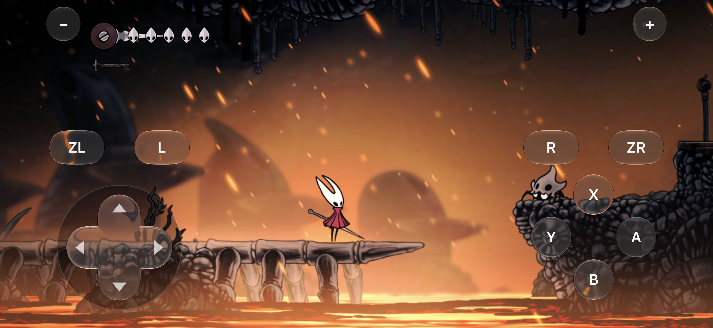
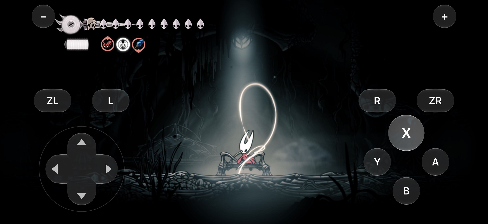
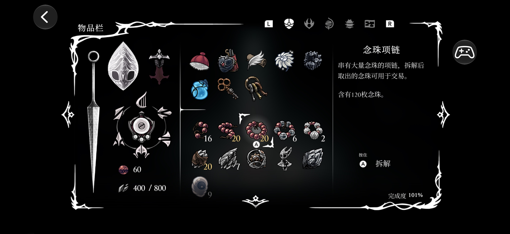
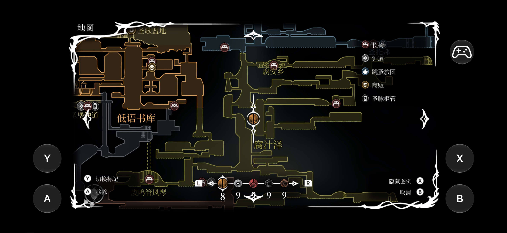
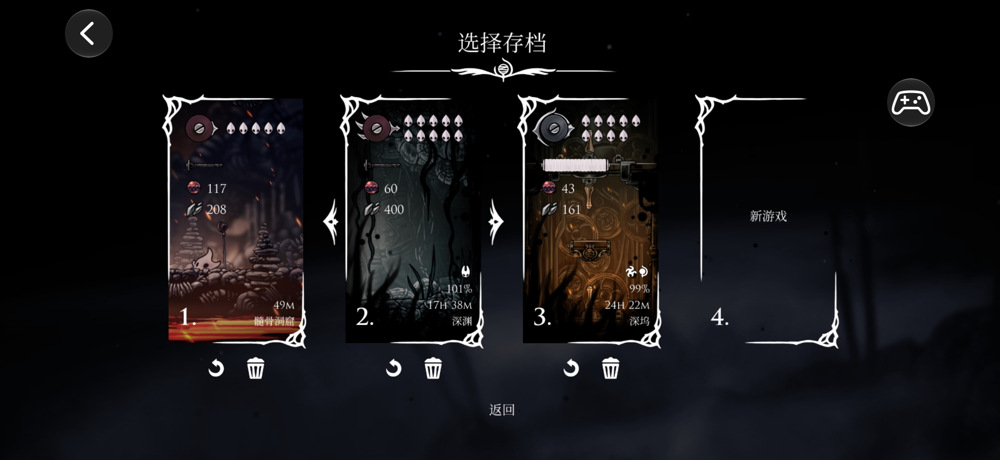
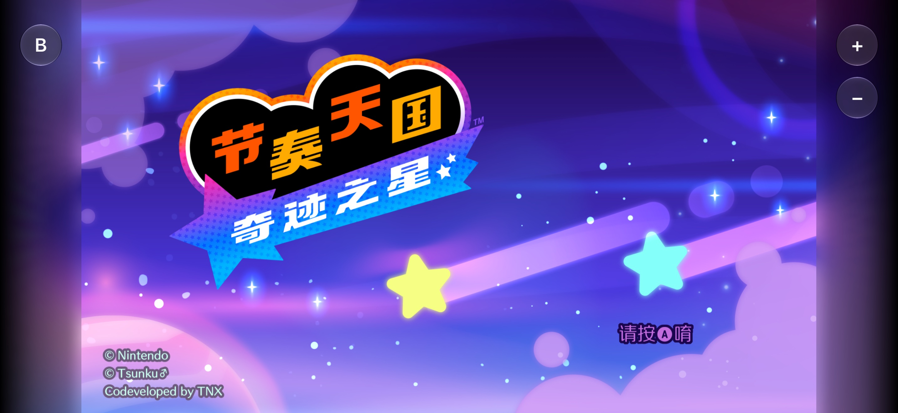
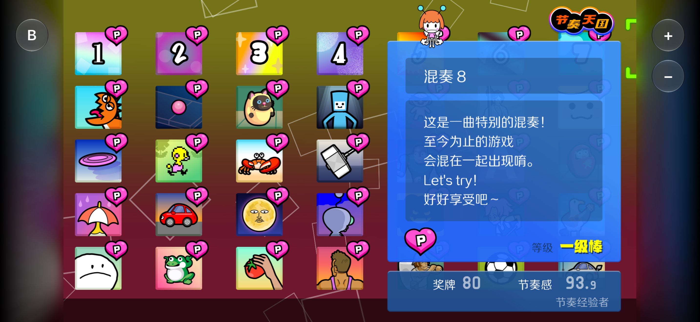
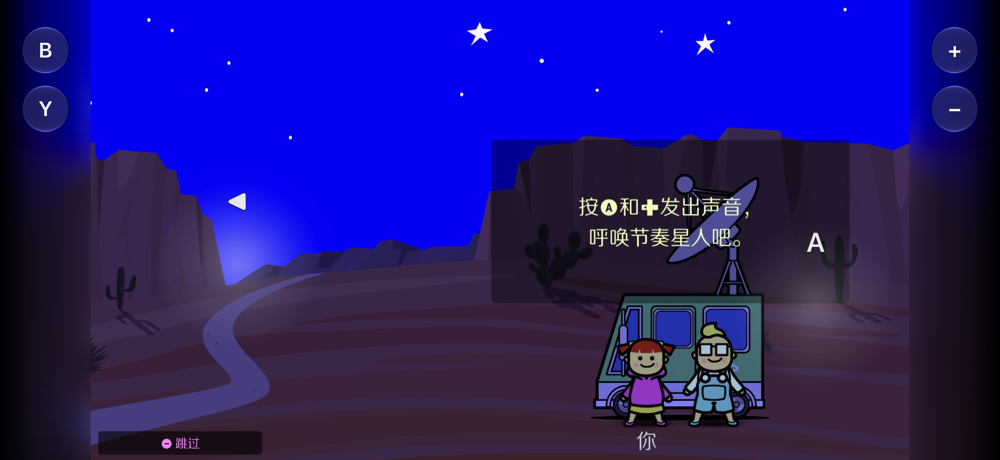
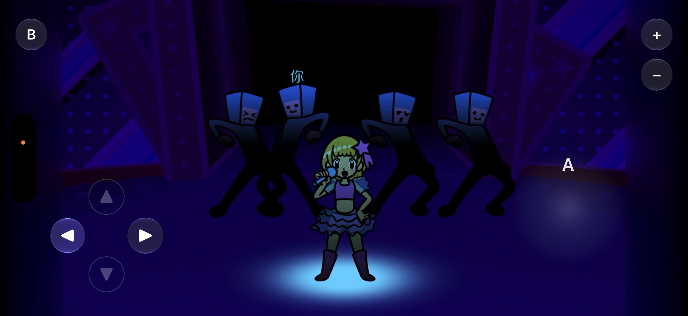

# Screenshots

These screenshots come from an iPhone running the Touchable builds.
The games use the Chinese language setting.

## Hollow Knight: Silksong

The Liquid Glass virtual controller in gameplay. The picture fills the wide screen.

A pressed button lights up with the system glass press effect.

Menus work by touch. Tap an item, or drag to scroll. The controller button at the top right brings back the pad.

On the map, only Y, A, X, and B show at the screen edges. Drag to move the map.

Tap a save slot to select it. Tap it again to load it.

## Rhythm Heaven

The title screen shows only B, +, and −. The ambient border glow fills the sides.

On the level map, drag left and right. Tap a level to select it. Tap it again to start it.

In a level, the two halves of the screen are touch areas for the level's controls. Only the buttons that the level uses show.

A level that uses the D-pad shows a small glass D-pad. The right half of the screen is A.

---

Game names and artwork belong to their owners. See [License and disclaimer](README.md#license-and-disclaimer).
